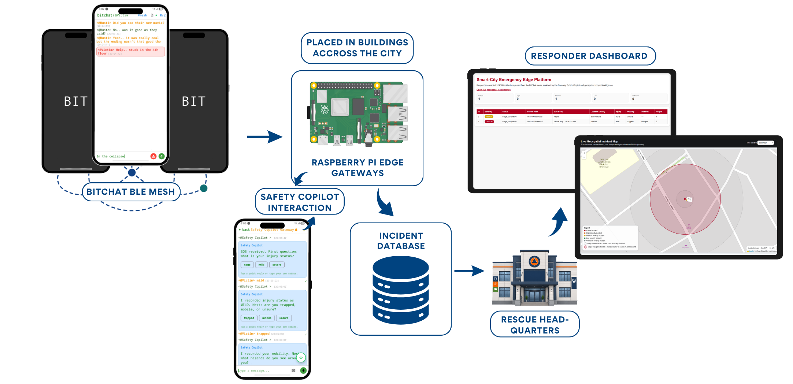
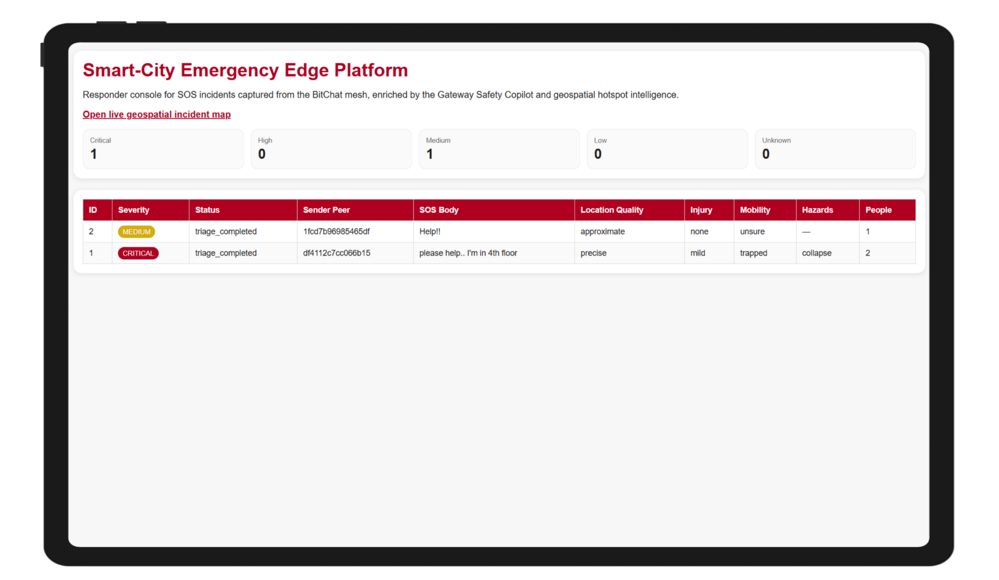
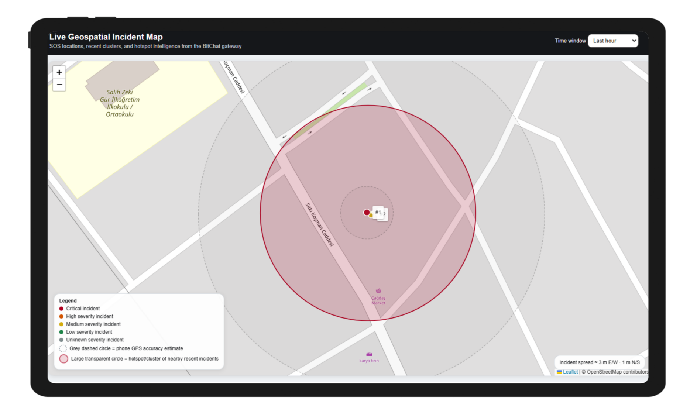
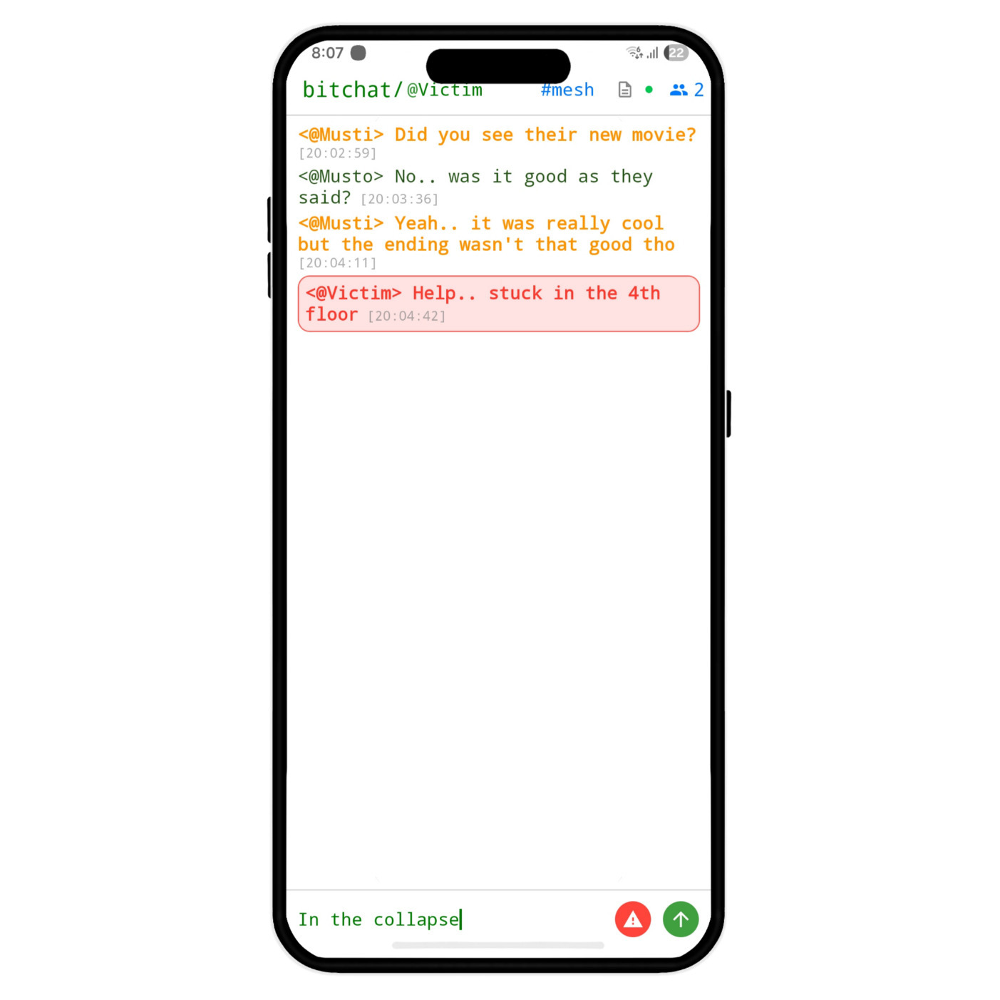
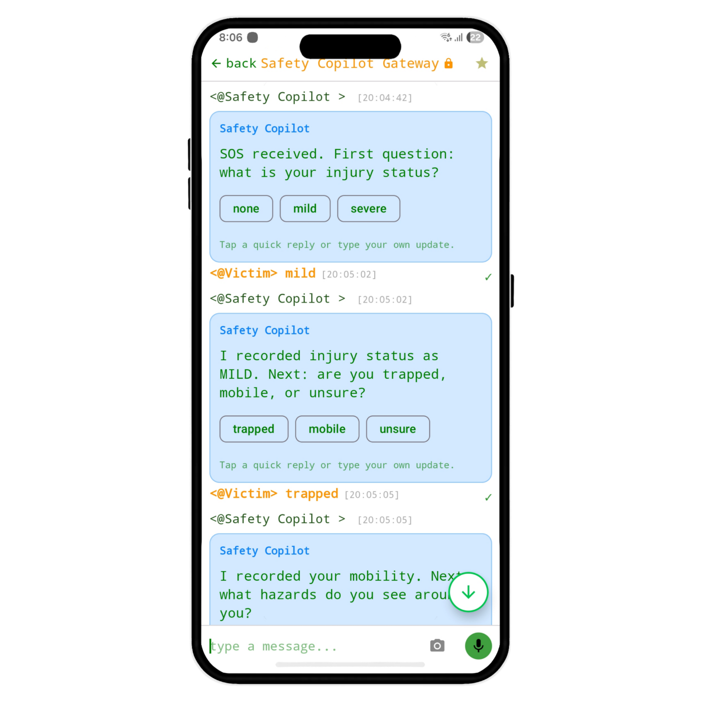

# Smart City Emergency Edge Platform

**Offline-first emergency SOS communication and local responder awareness using a modified BitChat Android client, Bluetooth Low Energy (BLE) mesh communication, and a Raspberry Pi 4B edge gateway.**

**Software Engineering graduation project** — Muğla Sıtkı Koçman University (MSKU) · 2026

> **Research prototype — not for real emergencies.** This is an academic proof of concept, not a certified or field-validated emergency-response system. Message delivery, security, location accuracy, safety guidance, and reliability have not been validated for operational disaster response.

## Overview

During disasters, cellular or internet infrastructure can fail or become overloaded. This project explores how mobile devices can exchange structured SOS reports over decentralized BLE communication, while a nearby edge gateway collects incidents and makes them visible to responders over a local network.

The graduation demonstration used **two Android phones**, **one Raspberry Pi 4B**, and **a laptop**. The phones exchanged traffic through the modified BitChat implementation; the Raspberry Pi processed SOS reports; and the laptop opened the gateway-hosted dashboard over a local Wi-Fi connection **without internet access**.

### Main capabilities

- **SOS messaging:** A modified BitChat Android application sends JSON-formatted SOS reports containing the message, timestamp, and available coordinates and location accuracy.
- **BLE gateway:** A Raspberry Pi uses `bleak` to discover/connect to compatible BitChat peers and listen for relevant mesh traffic.
- **Deduplication and storage:** The gateway filters duplicate SOS reports and persists incidents in SQLite.
- **Safety Copilot:** A rule-based assistant follows up by private message to ask about injury, mobility, hazards, and number of affected people. Answers enrich the incident and inform a prototype severity classification.
- **Responder dashboard:** A locally hosted Flask dashboard and JSON API display incidents, geographic information, and nearby-incident hotspot analysis.

## System architecture



**Important scope:** This prototype demonstrates **one Raspberry Pi gateway**. Automatically synchronizing independent gateways across a city is **not yet implemented**.

## Screenshots and Demonstration

### Responder Dashboard

The local Flask dashboard provides responders with incident information through a structured table view and a geographical map with hotspot detection.

| Incident Table View | Incident Map View |
|:---:|:---:|
|  |  |

### SOS and Safety Copilot on Android

The modified BitChat Android application enables users to send structured SOS reports and interact with the rule-based Safety Copilot through predefined follow-up questions.

| SOS Messaging Interface | Safety Copilot Interface |
|:---:|:---:|
|  |  |

### End-to-End Demonstration

The following video demonstrates the prototype's end-to-end workflow, from SOS reporting through the modified BitChat Android client to incident processing on the Raspberry Pi edge gateway and visualization on the responder dashboard.

🎥 **[Watch the Project Demonstration on YouTube](https://www.youtube.com/watch?v=dOo4ODE91qo)**

*Note: This is an academic prototype demonstration, not a validated emergency-response deployment.*

## Source repositories

- **Raspberry Pi gateway and responder dashboard:** Raspberry Pi gateway, Safety Copilot, incident database, and dashboard source code (included in this repository).
- **Modified Android client:** [Mestafa24/bitchat-android](https://github.com/Mestafa24/bitchat-android).
- **Original upstream Android project:** [permissionlesstech/bitchat-android](https://github.com/permissionlesstech/bitchat-android).

### Gateway code structure

| File | Responsibility |
| --- | --- |
| `pi_listen.py` | BLE discovery, connections, packet reception, SOS processing, and copilot routing |
| `bitchat_protocol.py` | BitChat packet decoding and encoding |
| `bitchat_pm.py` | Encrypted private-message session and gateway identity handling |
| `gateway_store.py` | SQLite incident and conversation storage |
| `copilot_engine.py` | Rule-based Safety Copilot and prototype severity processing |
| `geo_intelligence.py` | Coordinate quality and geographic/hotspot analysis |
| `gateway_api.py` | Local Flask dashboard, map, and HTTP endpoints |
| `requirements.txt` | Direct third-party Python dependencies |

## Technical stack

**Android:** Kotlin, modified BitChat client, Bluetooth Low Energy (BLE), and device location services.  
**Edge Gateway:** Raspberry Pi 4B, Python 3.10+, Bleak, Cryptography, and SQLite.  
**Responder Dashboard:** Flask, local HTTP API, Leaflet, OpenStreetMap, and geospatial hotspot detection.

## Setup (developer prototype)

### 1. Requirements

- A Raspberry Pi 4B (or compatible Linux device), functioning BLE adapter, and Linux Bluetooth/BlueZ services.
- Python **3.10+** and `venv` support.
- A modified BitChat Android client compatible with the SOS format.
- For dashboard access from another device: a working **local Wi-Fi/LAN** connection between the device and Raspberry Pi. Internet access is not required for local API/dashboard access.

### 2. Install the Python packages

Open a terminal in this repository's root directory:

```bash
python3 -m venv .venv
source .venv/bin/activate
python -m pip install -r requirements.txt
python -m pip check
```

Direct Python package dependencies are **`bleak`, `cryptography`, and `Flask`**. Standard-library modules such as `sqlite3`, `json`, and `asyncio` are not listed in `requirements.txt`. Linux Bluetooth permissions and OS dependencies may require separate setup.

### 3. Start the gateway listener

```bash
python pi_listen.py
```

### 4. Start the dashboard in a second terminal

From the **same repository directory**, activate the same virtual environment, then run:

```bash
source .venv/bin/activate
python gateway_api.py
```

From a browser on the same local network, visit:

- `http://<PI_LOCAL_IP>:8080/` — responder dashboard
- `http://<PI_LOCAL_IP>:8080/map` — incident map view
- `http://<PI_LOCAL_IP>:8080/health` — health/status endpoint

The listener and dashboard share the relative path `sos_gateway.db`, so they should be launched with the same working directory. The database and `.gateway_identity/` key files are generated locally and **must not be committed**.

> These are developer-oriented starting instructions. Dependency import checks on a PC do **not** replace running and testing the BLE gateway on a Raspberry Pi.

## Offline behavior and current limitations

- **Works without internet:** BLE-based SOS exchange (within the tested prototype), local SOS processing, SQLite storage, rule-based copilot logic, and LAN-hosted dashboard/API.
- **Not yet a fully offline street map:** The current map page references Leaflet CSS/JavaScript from an online CDN and OpenStreetMap online tiles. It contains a simpler coordinate-plot fallback when the map resources are unavailable.
- **Single gateway:** Multi-gateway discovery/synchronization is future work.
- **Prototype security:** The dashboard has no production-grade access control; keep it on a trusted network using synthetic data. Do not expose its port to the public internet.
- **Unvalidated emergency use:** BLE reliability, geographic accuracy, range, message latency, scale, and triage guidance require controlled tests before any operational use.

## Next steps

- Package map JavaScript/CSS and suitable map data for fully offline use.
- Improve BLE delivery reliability, testing, and reproducibility across Android/Raspberry Pi environments.
- Add authentication and data protection to the responder dashboard.
- Explore multi-gateway synchronization across buildings using an available local/intermittent backhaul.
- Add automated tests, deployment instructions, and quantitative evaluation results.

## Acknowledgments

This project builds on the open-source **BitChat Android** application by its original maintainers and contributors. The graduation project added an SOS workflow in a modified Android fork and implemented the Raspberry Pi gateway, Safety Copilot logic, incident database, and responder-facing dashboard.

<!-- OPTIONAL CONTACT — replace with your real public LinkedIn URL before enabling:
## Contact
[LinkedIn](YOUR_LINKEDIN_URL)
-->
